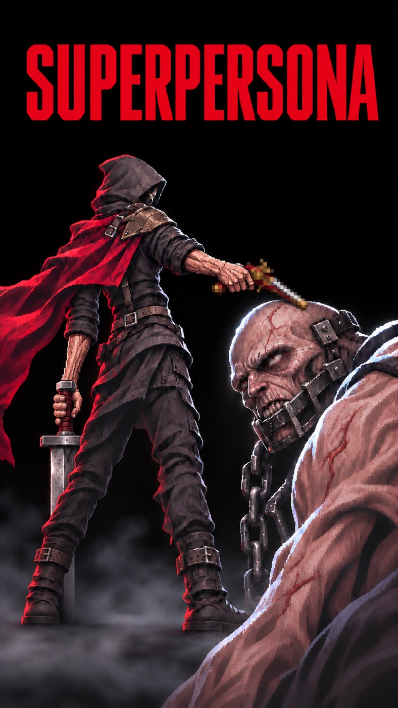

# SUPERPERSONA

**Action horror 2D a stanze. Spada, pistola, orde.**

SUPERPERSONA è il primo gioco di **Roccia Games**: un action horror in pixel art dove si entra in una stanza, si chiudono le porte e arriva l'orda. Si sopravvive con una spada, una pistola e un mantello rosso.

**Sito:** [rocciagames.com](https://rocciagames.com)

## Il gioco

- **Spada e pistola insieme.** Fendenti, raffiche, scatti, salti e schianti dall'alto: si passa da un'arma all'altra senza fermarsi.
- **Orde.** Decine di nemici dagli occhi rossi, da tutti i lati e dall'alto.
- **Mini boss.** Il Carceriere, il Pressatore e il Tessitore fanno la guardia alla Sala del Sigillo, ognuno con le sue mosse.
- **Buio e luce.** Si vede solo quello che la luce del protagonista raggiunge. Il resto sono occhi nel nero.

## Il gioco e l'album

SUPERPERSONA è anche un album: **24 tracce, 24 zone, 24 boss**. Ogni zona del gioco è una traccia.

L'album si ascolta su [RocciaMusic.com](https://www.rocciamusic.com).

## La demo

La demo si gioca nel browser, da computer, su [itch.io](https://therealgallo.itch.io/superpersona). Sul sito c'è anche il video di gameplay.

## Roccia Games

Roccia Games fa giochi originali dalla musica di Roccia Music.

[Instagram](https://www.instagram.com/therealgallo.recs/) · [RocciaMusic.com](https://www.rocciamusic.com)

---

© 2026 Roccia Games. Tutti i diritti riservati: gioco, grafica, musica e testi non sono liberamente riutilizzabili.
